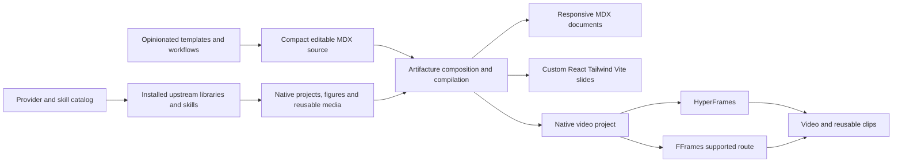

# Templates and workflows for Artifacture

Artifacture's product is opinionated, tasteful templates and workflows. Compact MDX authoring and a thin rendering pipeline make those templates economical to use. Most primitives stay with upstream libraries. Slides use a fully custom React/Tailwind/Vite renderer pipeline; HyperFrames and FFrames own the selected native video rendering routes. This product boundary was clarified by the user on October 11, 2026.

The user selected a breaking release, on-demand dependency fetching, and a small entry skill backed by a catalog. Authoring uses compact MDX with editable native project handoffs; templates supply choreography and allow extensive customization. Cross-format reuse shares content, themes and assets. The launch catalog includes existing slide and video workflows alongside PR review and explainers. Good diagrams and slides are primary sources of utility. F-explainer originally used Artifacture, as clarified by the user; its Function Intelligence slides are a downstream preservation baseline. The user approved this direction and the adversarial amendments on October 11, 2026. Implementation has started. FFrames is the preferred native video route; use HyperFrames for browser-dependent compositions.

## Evidence behind the change

[PR #26](https://github.com/theclaymethod/artifacture/pull/26) merged into `main` at `f790de73027d7b5332eb8f1f1f77001590b4b4ed`. Both PR CI jobs passed. It adds document navigation, tables, code highlighting, disclosures and review components. These features become migration inputs; merging them does not decide their permanent ownership.

The local architecture audit uses the current checkout at `b6a00d0` plus existing uncommitted work. It is not an audit of a combined post-merge tree. Existing local changes are preserved.

| Observed input | Measurement | Implication |
| --- | --- | --- |
| Bundled skill runtime | 3,028 entries; approximately 16.70 MB compressed and 57.55 MB serialized JSON | Installing an instruction skill also distributes a substantial runtime snapshot. |
| Actual archived file content | 42,910,910 bytes | Use this denominator for content shares; serialized JSON size includes encoding overhead. |
| Vendor tree | 2,343 files; approximately 25.99 MB of file contents | Most external code is delivered whether the project needs it or not. |
| Largest vendor trees | Lemo Opuscar 12.81 MB; Shaders 6.05 MB; Diagram Design 5.28 MB | External dependency selection is a more consequential boundary than trimming a few CLI wrappers. |
| Generated Diagram Design example module | Approximately 4.30 MB | Original HTML examples are represented twice: vendor files and generated TypeScript. |
| All generated upstream example copies | 4,706,289 bytes | Galleries can resolve originals without shipping generated mirrors in the default runtime. |
| Evals in the consumer runtime | 212 files; 4,833,124 bytes | Contributor evaluation assets need not be a consumer dependency. |
| Existing compact MDX example | `web-diagram.mdx`: 1,155 bytes; its generated HTML: 443,144 bytes | Editable MDX is compact. The HTML includes runtime and styles, so this is not a controlled token-savings benchmark. |
| Existing provider resolver | `scripts/visual-sources.mjs` resolves bundled files, native packages and exact-revision external caches | Dependency routing already has a useful seam. It need not start as a new plugin framework. |

Vendors and generated upstream copies represent 71.5% of actual archived file content. Keeping those dependencies on demand and evals development-only would remove 35,531,934 bytes from the current default content set. This is a packaging opportunity, not a prediction of compressed size or equivalent visual quality.

Local implementation remains substantial after packaging: excluding generated source, vendors and tests, the MDX/component directory has 98 files and 13,101 lines; root scripts have 5,817 lines; skill-side scripts have 8,298 lines. The current source-copy registry exposes 64 entries. Distribution changes alone do not settle the ownership of this code.

## Proposed ownership

Templates and workflows are the primary authored assets. The pipeline, dependency catalog and CLI exist to make them easy for agents to discover, customize and deliver. A supported upstream API should be the first primitive implementation choice. A local adapter earns its place by bridging a specific unsupported boundary, with an example that demonstrates the need.

| Responsibility | Artifacture owns | Upstream owns |
| --- | --- | --- |
| Templates | Finished compositions, narrative structure, typography, spacing, theme choices and authored choreography | The primitives used inside those compositions |
| Custom slides | React/Tailwind/Vite authoring, template-owned slide compositions, interaction/state and editable workspace build pipeline | Visual/animation primitives used by each slide; useful export/capture tools where applicable |
| Workflows | Selecting a suitable template, gathering evidence, adapting its story, reviewing and delivering the result | Specialist creation and rendering procedures already covered by native skills |
| Authoring | Compact MDX, content composition, imports and references to reusable assets | Specialized illustration, diagram and animation authoring APIs |
| Theme | ISO and other accepted theme tokens; small mappings where providers expose tokens | Provider geometry, materials and native figure behavior |
| Discovery | A machine-readable catalog with capabilities, installation instructions, provenance and supported outputs | The authoritative component API and skill instructions |
| Dependencies | Selected native installation commands; small revision receipts only for source-only repositories | Native manifests, lockfiles, package/skill installers and caches |
| Pipeline | Composable MDX support and templates using one project-owned Vite configuration for dev/build/export | Native video project scaffolding, scene runtimes, media processing and encoding |
| Delivery evidence | Source/version identity and checks needed to establish the delivered output | Native renderer inspection and validation where already available |

The public promise should distinguish shared content, theme and asset identity from exact geometry or animation equivalence. Preserving identical motion across unrelated engines is a separate, expensive commitment. Ordinary image/video paths are sufficient for reuse. Existing `NativeClip`/`NativeStill` metadata is optional; engine/theme enums, frame caps and sampled still requirements must not gate generic media imports.



MDX is the default compact narrative and composition source. It can reference independently authored native projects and assets. Authors can move into ordinary TSX, JavaScript, HTML or native renderer source when needed, without converting the result back into a proprietary Artifacture scene model.

## What a template delivers

A template is a working, finished starting point with an intentional composition. It should carry:

- Editable MDX and native composition source where needed, with meaningful content slots and selected provider imports.
- A narrative or reading structure: what the viewer needs to understand, the sequence of visual consequences, and where evidence belongs.
- Authored typography, spacing, theme mappings and motion choices for that use case.
- A preview and output example that show what the agent can actually produce.
- Selected provider dependencies and supported output routes, without distributing every provider's gallery.
- A workflow for adaptation, export, review and reuse within a collection.

Diagrams and slides are primary catalog surfaces. The initial catalog also includes PR review, technical mechanism explanation, non-technical explanation and the existing slide/video workflows. A sizzle reel has a different structure from an explanatory argument and remains a distinct template where supported. Existing examples should seed this broader catalog; entries must distinguish a finished working template from an unverified workflow proposal.

Templates are editable starting points. Compact content slots and authored choreography provide an efficient default, while ordinary source editing, direct vendor imports, custom scenes and native project handoffs permit extensive customization. Do not require an eject command, a fork of Artifacture, or a growing override schema to work outside the default composition. Preserve access to the native source when scaffolding.

The agent-facing catalog should lead with these finished templates and their intended use. A separate provider view answers which primitives and skills a selected template can pull in. The CLI should scaffold the chosen template, provision its selected dependencies and delegate native commands. It should not require the agent to assemble every explanation from an undifferentiated primitive index.

Native APIs remain visible and available inside templates. The selected cross-format contract shares content, themes and assets. Reuse can preserve a provider's source or reuse its rendered clips and stills; it does not guarantee identical live geometry and animation across renderers.

## Diagrams and slides as primary products

Diagram templates own the explanatory composition: the relationships that matter, grouping, visual hierarchy, label placement requirements, theme, responsive reading and the selected upstream workflow. Specialist libraries remain responsible for their native geometry and layout. Suitable starting families include system architecture, process/flow, dependency DAG, before/after code-change maps and isometric mechanism explanation.

Slide templates own the reading or presentation sequence, layouts, typographic rhythm, progressive explanation, meaningful interactions and reusable diagram/media placement. The user requires a fully custom React/Tailwind/Vite renderer pipeline and the ability to make slides like the function slides in f-explainer. That is a selected first-party capability, not a surface to replace with a mandatory presentation framework. Preserve the useful distinction between responsive reader decks and fixed-stage interactive presentations; both can share content and assets.

Videos are another principal output. They can reuse diagram and slide content, themes and assets, while templates supply film-specific staging, timing, narration and transitions. Existing deck-to-video guidance is an adaptation workflow, not proof that every interactive deck can be converted automatically.

### Launch catalog grounded in existing work

The following families preserve useful workflows, not their current implementation ownership. Examples and receipts were inspected without rerunning them. Refresh starter sources and verify the migrated outputs before publishing the new catalog.

| Surface | Template/workflow families | Existing source and evidence |
| --- | --- | --- |
| Diagrams | Process/flow, ownership and architecture maps | `web-diagram.mdx`, `diagram-canvas.mdx`, `artifacture.architecture.json`; foundation and style-refinement receipts record layout, routing and interaction checks. |
| Diagrams | Progressive mechanism explanations and dependency DAGs | `animated-diagram.mdx`, `dag.tsx`; walkthrough stepping and finite-motion receipts exist. DAG is implemented and example-backed; a dedicated encoded-film receipt was not found in this lookup. |
| Diagrams | Isometric mechanisms, physical plans and exploded assemblies | `axonometric.tsx`, original Diagram Design figures and source-video jobs; selected original-source diagrams have real rendered footage. Anatomy expands the native mechanism route. |
| Slides | Responsive reader decks and horizontal magazines | `slide-deck.mdx`, `clean-rich-slides.mdx`, `magazine-deck.mdx`; existing export, browser and PDF journeys. |
| Slides | Fixed-stage interactive talks, progressive states, drill-downs and layer exploration | `presentation-deck.tsx`; the existing presentation runner exercises these interactions, with 24 browser checks recorded in `docs/verification/e2e-and-primitives.md`. |
| Slides | Comparison, process, diagram, data, code, evidence and decision compositions | Existing slide patterns and deck examples. These are authored composition choices; they need not become a new mandatory primitive system. |
| Videos | Narrated technical/non-technical explanations, mechanisms and tutorials | Existing mode contracts and a real 192.7-second narrated teaching film. The non-technical collection example is a silent draft, not a completed narrated film. |
| Videos | PR review, code walkthrough and diff explanation | Existing cards, native PR Lens route, code-diff examples and an actual 130.17-second narrated PR #15 film; `docs/verification/agent-video-2026-10-05.md` records checks. |
| Videos | Portrait/landscape reels, shorts, sizzle reels and capability tours | Real reel demo MP4s and a 107.4-second narrated primitive tour. Older reel demos require visual refresh before representing the new defaults. |
| Videos | Deck adaptation and related episode collections | Existing `/render-video` guidance and collection compiler with two silent episode drafts. Automatic arbitrary-deck conversion and a completed narrated series are not established. |

The catalog can index these families under diagrams, slides and videos, with viewer purposes such as PR review, explanation, tutorial and decision comparison. Useful entry data includes the supported inputs/outputs, dependencies, theme compatibility, editable source, a real preview and its verification scope. These fields support selection and provenance; they are not decorative UI badges.

The current fixed-stage presentation implementation is 1,988 lines, mixing navigation with layout, icons, diagrams and drill-card components. Its size alone does not justify replacing the custom slide pipeline. Separate purposeful template/runtime behavior from duplicated visual primitives during the caller inventory.

The custom slide pipeline compiles compact MDX and ordinary React/TSX slide compositions through Vite, with Tailwind and shared theme tokens. Templates provide authored layout and interactions while allowing direct source customization. Native libraries supply figures, charts and motion primitives. A small shared deck runtime can own navigation, ordered states and figure lifecycle without requiring each template to duplicate those mechanics.

Function Intelligence in `/Users/claytonkim/dev/f-explainer` is downstream work that originally used Artifacture. Its slides demonstrate what Artifacture's authoring workflow already enabled. The refactor must preserve that expressive range and customization.

The downstream project has canonical React slide components, a shared deck runtime and an optional content-only `<FunctionSlide spec={spec} />` starter API. Its current standalone exporter uses Bun and inline CSS. Artifacture already has Vite/React/Tailwind compilation in `scripts/ve-mdx/export.mjs`; preserve the experience using that build boundary rather than carrying a second exporter. Existing consumer-owned renderers remain valid native handoffs.

F-explainer's initial commit, `c9cacff19d16b6ad617f002fc8cacd03e929a62d` on July 24, explicitly used Artifacture for TSX export and slide verification. The current [student repository builder](/Users/claytonkim/dev/f-explainer/evals-bootcamp/tools/build-student-repo.mjs) still discovers Artifacture and invokes `npm --prefix <artifacture> run ve:export -- <deck.tsx> --out <output>`. Its [browser tools](/Users/claytonkim/dev/f-explainer/tools/decks/browser.mjs) also retain Artifacture dependency discovery. These are concrete downstream pipeline contracts.

Consumer-specific deck runtime development and upstream reuse both followed. Artifacture's [F-explainer provenance](../../visual-explainer-mdx/F-EXPLAINER-PROVENANCE.md) already records selected graphics from source revision `5f57ca1516518939cf833a814aaba3104ea035f1`. Similar presenter code is divergent adaptation, not a currently shared npm runtime; the history does not establish literal copy direction for every primitive.

### Downstream Function Intelligence preservation contract

| Preserve | Source-grounded contract |
| --- | --- |
| Unrestricted slide composition | [Function deck](/Users/claytonkim/dev/f-explainer/function-intelligence/function-intelligence-deck.tsx) registers ordinary `React.ComponentType` slides with stable IDs and mounts the active component. Compact MDX and arbitrary TSX remain first-class sources. |
| Efficient optional starters | [Authoring API](/Users/claytonkim/dev/f-explainer/deck-runtime/authoring.tsx) has `FunctionSlideSpec` and four layouts: case, comparison, process and decision. A starter spec is a shortcut; fully custom React composition remains available. |
| Custom stage and presenter | Configurable canvas, full-bleed compositions, arbitrary children, rail/dock and presentation controls. Separate content from shell and theme. Hide repeated brand/kicker/footer chrome by default. |
| Ordered explanation states | [Deck shell](/Users/claytonkim/dev/f-explainer/deck-runtime/function-deck-shell.tsx) exposes `useDeckStateNavigation` and cancelable `presentation-state-navigate` events. Capture/review can discover state progression without inspecting private component internals. |
| Shareable slide identity | Stable slide IDs, hash navigation, history/back-forward and titles. The current Artifacture presenter does not already implement the complete Function registry/hash contract. |
| Rich interactive figures | React SVG, Canvas, Three, native source adapters, camera interaction and drill surfaces, with explicit lifecycle. Retain canonical figure ownership and use upstream primitives where suitable. |
| Portable delivery and review | Standalone HTML; one physical React/Three instance; assets/fonts and provenance; state-aware browser captures and frozen output identity. |

The [intelligence loop](/Users/claytonkim/dev/f-explainer/slide-lab/deck/slides/experiments/function-intelligence-canonical/slide.tsx) demonstrates multi-act playback, seek/pause, ASCII/WebGPU scenes, camera takeover and renderer prewarming. The [clinical reasoning graph](/Users/claytonkim/dev/f-explainer/slide-lab/deck/slides/experiments/clinical-reasoning-graph/slide.tsx) demonstrates beat/overview navigation, focused cameras, pan/zoom and expandable reasoning. These are the representative custom capabilities to preserve; the canonical sources belong to Slide Lab rather than duplicate files in each deck.

Existing Function receipts record eight starter frames and 93 full-deck states, with known graph density and tree containment findings. They do not certify every animation frame or mobile layout. Interactive figures use animation-frame loops; automatic deterministic video export of arbitrary Function slides is not established. Explicit film choreography and native handoffs remain necessary.

Use the downstream project to identify proven reusable templates, authoring improvements and runtime contracts worth promoting into Artifacture: stable registration/URL semantics, discoverable presentation states, state-and-drill-aware review, optional teaching starters and offline asset handling. Preserve consumer-specific compositions and assets in their project. Do not make f-explainer a required provider dependency or vendor its full implementation. New shared templates should have one runtime owner; existing decks can retain their own presenter. The two current presenters map keyboard directions differently, so verify the chosen behavior. Preserve existing source/asset ownership and third-party notices when selecting reusable code.

For the breaking release, representative Function Intelligence slides and direct Artifacture export callers are acceptance baselines: custom React composition, progressive states, drills, stable links, rich figures and portable output should remain usable. The compiler must accept a consumer's existing presenter, components, CSS and assets rather than require a new built-in shell. Retain the TSX handoff or supply a small explicit migration bridge for the existing export invocation. Run existing consumer/browser checks and direct probes on an isolated candidate before removing replaced Artifacture code. This preserves capability without promising every old import stays unchanged.

Known starter refresh work from existing receipts: `shared-graphics-slides.tsx` passes unsupported `reviewTools`; a broader example typecheck recorded a widened edge ID in `video-longform.tsx`. These sources should not be republished as new-release starters without correction and verification.

## Accepted CLI and workspace contract

```text
artifacture list [--kind diagram|slides|video|reference] [--query text] [--json]
artifacture info <template-or-reference> [--json]
artifacture init <new-directory> --template <id> [--no-install] [--no-skills] [--dry-run]
artifacture skills install [new-skill-directory]
```

Templates own their native project manifests and commands. For React/Tailwind/Vite workspaces, `npm run dev`, `npm run build` and `npm run export` use the same configuration. Standalone export is a mode of that build using the upstream single-file plugin. Artifacture supplies composable MDX support without injecting its own application, CSS or temporary dependency tree.

A native FFrames template invokes the upstream scaffolder, then the author uses the generated Cargo commands. Renderer choice belongs to the template. There is no renderer-switch flag or universal project compiler. Native package managers own locking, cache and updates. Skills are fetched for selected templates; there is no cross-ecosystem Artifacture lockfile.

One manifest beside each template records purpose, output, source route and references. Dependency details come from the actual project manifest. Discovery stays compact and detailed instructions load only after selection. Native APIs are linked rather than copied into a second component registry.

## Token efficiency and customization

Optimize the default authoring and agent reading path, rather than minimizing the size of generated HTML at the expense of capability. A compact catalog query should lead to one selected template and only its relevant native references. Avoid loading the whole component barrel, example gallery or renderer manual into each task.

Keep ordinary MDX, native imports and editable files. Template content slots can reuse shared content/data modules, but should not grow into a new universal scene language or a comprehensive override schema. Native projects remain editable when the author needs custom interactions, layout or motion. The pipeline should accept those handoffs without reconstructing them into our primitive model.

Measure source size, instructions read, dependency footprint and actual recorded agent usage where available. The existing MDX/generated-HTML byte ratios are not a token-efficiency benchmark. A future comparison needs equivalent briefs and quality requirements; do not report character-count estimates as observed token usage.

A first-party primitive is justified only when a supported template needs a capability without a suitable upstream implementation. Duplicated geometry, renderer behavior and generic animation helpers are migration/deletion candidates. Spinning them into another package is not automatically an improvement.

## Provider routes

### Anatomy

Anatomy has two MIT products. The [authoring skill](https://github.com/wheresryan22/anatomy) creates custom working-machine illustrations; [`anatomy-figures`](https://github.com/wheresryan22/anatomy-figures) supplies 52 existing figures through direct imports and custom elements. Their native installation routes are `npx skills add wheresryan22/anatomy` and `npm install anatomy-figures`.

Use the package for a suitable existing mechanism and the skill for a new mechanism. Anatomy explicitly excludes charts; it should not become the default for every visual. General architecture diagrams, DAGs and quantitative charts retain specialist routes.

Prefer its native API over an Artifacture recreation:

```mdx
import Mutex from "anatomy-figures/mutex";

<Mutex theme="light" tokens={{ "--anatomy-weight": "0.6px" }} />
```

The [collection API](https://skills.wheresryan.sh/anatomy/collection#use) exposes theme tokens including `--anatomy-weight`, an accent and shading tones. That provides a small ISO integration seam. Nineteen early figures support only the base theme and card background; the complete token mapping cannot be promised for them.

Published `anatomy-figures@0.1.0` has no public time, seek or play prop. Inspected Watch and Turbofan implementations advance private animation-frame state. The package is approximately 21.29 MB unpacked. Do not bundle it by default or claim deterministic film support without a prototype. Prefer a supported native handoff or captured reusable clip over rebuilding each mechanism.

Research pins: Anatomy skill `dbf697a527bbf7d358668e1557cb1e35ff725d46`; figure repository `d4590e39369d813cd98450f6f6407634a25ad85a`; published figure package `0.1.0`.

### Diagram Design and other visuals

Diagram Design should own diagram selection, original templates, geometry and motion. The recent vendor refresh preserves its originals, but the new proposal would resolve that dependency on demand rather than distribute its entire gallery in every skill runtime. The current companion installer and source resolver are migration inputs.

Prefer native package imports where available, such as Anatomy figures, Hairline, PR Lens and Shaders. Keep native clip producers such as Manim and Psychopomp optional. Each provider should declare whether its output is static, interactive, seekable or reusable media. A catalog entry must not imply all four capabilities.

### HyperFrames

The current local route already invokes the upstream renderer, but also owns a React/SVG sequence runtime and absolute-time sampler. Upstream HyperFrames provides native animation adapters, media, audio, captions, inspection and rendering. Its [frame adapter interface](https://github.com/heygen-com/hyperframes/blob/main/packages/core/src/adapters/types.ts) exposes duration, frame seeking and lifecycle. Necessary adapters should target that interface rather than establish another Artifacture clock.

Recommend native project folders and native CLI dispatch first. Embedding the [producer API](https://github.com/heygen-com/hyperframes/blob/main/packages/producer/src/index.ts) can follow a demonstrated need. Existing HyperFrames skill instructions should stay upstream. Our local guide has already drifted on repeat rules and GSAP skill discovery.

The [upstream skill catalog](https://github.com/heygen-com/hyperframes#skills) includes explainer, PR-to-video, slideshow, animation and audio workflows. Artifacture should route to them and add only its MDX, cross-format composition and evidence-specific guidance.

### FFrames

The current bridge accepts our SVG sequences, generates Rust projects and supports silent macOS Metal rendering. Those are the bridge's limits. [Native FFrames](https://github.com/dmtrKovalenko/fframes) has its own Rust/SVG timeline, scene, media and audio contracts.

A native-project handoff can preserve upstream capabilities. A universal HTML/MDX-to-FFrames translation would require considerable local implementation. Selected: prioritize native projects and prefer FFrames for composable native video templates. Retain the restricted SVG bridge only while an identified caller needs it; do not imply arbitrary browser compositions work in FFrames.

Renderer versions observed during research: HyperFrames npm `0.8.149`, Apache-2.0, Node >=22; FFrames stable crate `1.2.0`, MIT framework with separate codec terms. Native project manifests and lockfiles own installed versions and explicit updates. Research observations do not silently update existing workspaces.

## Skill packaging alternatives

Selected: one small Artifacture entry skill and a catalog. Fetch selected upstream dependencies on demand and load the selected upstream skill when needed. Do not copy its full technical instructions into local fallback guides. Selective independently installable workflow skills remain candidates, rather than a requirement to publish a compendium of every current skill.

The entry skill teaches agents to select and adapt a finished template. Artifacture's distinctive skill content is taste, narrative, composition and delivery workflow. Native skills remain authoritative for the underlying visual and rendering tools.

Potential Artifacture skill owners:

- Template selection and art direction: choose an appropriate composition, adapt its content and retain its visual standards.
- MDX authoring and compilation: our compact source contract and supported exports.
- Cross-format composition: reuse content, assets and themes across documents, slides and collections.
- Evidence-driven explanation: convert inspected source material into a narrative with visual consequences and reviewable claims.
- PR review: retain only Artifacture-specific evidence and composition; delegate upstream diagram and video workflows.

These are candidates, not a commitment to four separate packages. A focused workflow should be independently installable only if it has a distinct useful contract. A compendium can be an index of external skills; it does not require vendoring their contents.

## Migration sequence to validate

1. Product identity, a breaking release, on-demand fetching, a small entry skill plus catalog, compact MDX/native handoffs, customization and content/theme/asset reuse are selected. FFrames-first recommendations and native dependency managers are selected. Deliver in verified migration slices.
2. Inventory current callers and classify each feature as template/workflow, thin pipeline support, provider adapter or replaceable primitive implementation. Include PR #26's document/review features and f-explainer's actual downstream customizations. Promote demonstrated reusable workflows and contracts, while retaining consumer-specific compositions in their project.
3. Prototype representative handoffs: an Anatomy mechanism in an ISO MDX document; representative downstream Function Intelligence slides migrated to the custom React/Tailwind/Vite pipeline; a Diagram Design original reused in slides and a HyperFrames film; a native or explicitly restricted FFrames project. Inspect actual outputs and native source ownership. Resolve unsupported native timing through demonstrated adapters or reusable media, rather than questions deferred to the user.
4. Use native provider/skill installation and lockfiles. Keep custom resolution only for source-only repositories. Remove the recursive runtime/vendor snapshot after a fresh-install probe succeeds.
5. Migrate authoring examples and consumer imports. Delegate supported rendering and media operations to upstream tools. Delete local replacements only after caller migration and observable parity checks.
6. Split or shorten skills around useful workflows, publish the template catalog, provider index and migration guide, and measure the installed footprint and authoring cost again.

Use existing tests and direct runtime/browser checks. New test files are outside the current authorization. Do not delete older code solely because of its age; first identify its replacement and remaining callers.

## Accepted adversarial amendments

1. The workspace owns the single build configuration for development, production and standalone export. MDX support is composable; arbitrary React/presenters remain supported.
2. Native manifests, lockfiles, skill installers and caches own dependencies. Remove optional providers from core runtime dependencies as well as from the published archive.
3. Templates select their renderer. Prefer native FFrames for composition; use HyperFrames when browser APIs are needed. Avoid cross-engine translation.
4. Preserve expressive capabilities and directly migrate known consumers. A breaking release does not require old component APIs, keyboard semantics, generic migration tooling or a permanent compatibility framework.
5. Keep catalog entries small and derive package information from native manifests. Link authoritative APIs. Workflow recipes and runnable starters have different readiness.
6. Scope checks to startup, assets, selected states and output delivery. Native renderer inspection remains native; template-specific visual review stays with its workflow.
7. Reuse ordinary media paths. Rich receipts are optional rather than a mandatory Artifacture envelope.

## Required native references

- [ISO Glow](https://isoglow.dev/): fine-line isometric construction and causal lighting, native HTML/Three.js outputs.
- [Hairline](https://hairline.lucasmarkes.com/docs): native React figures and [authoring skill](https://hairline.lucasmarkes.com/skill).
- [iso-figure](https://github.com/MrBongoC/ai-iso-skill): native isometric authoring guidance.
- [FrankenManim](https://github.com/Dicklesworthstone/franken_manim): experimental reference. Its README explicitly mixes present capability with the 1.0 target; verify rendering support and current license before adoption. Do not vendor it or promise unverified video support.
- [Manim Community](https://docs.manim.community/en/stable/) and [ManimGL](https://github.com/3b1b/manim): distinct native mathematical-animation APIs and reusable media routes.
- Diagram Design and Anatomy remain first-class specialist references.

## First implementation slice

The candidate branch introduces a dependency-free discovery/scaffolding CLI, compact entry skill, two editable browser starters and native FFrames scaffolding. PR review and browser-video workflows are indexed as recipes. Browser compilation is one project-owned Vite configuration with native MDX, React, Tailwind and single-file plugins. The published package is allowlisted and excludes the vendor tree, generated galleries, evaluator corpora and bundled runtime snapshot.

This is the beginning of the breaking release. Existing legacy source scripts and primitives remain in the contributor checkout pending caller migration and direct parity checks. The full Function Intelligence migration, broad template catalog and deletion of replaced implementations remain subsequent slices. New test files are not authorized; use existing tests and direct runtime/browser probes.
